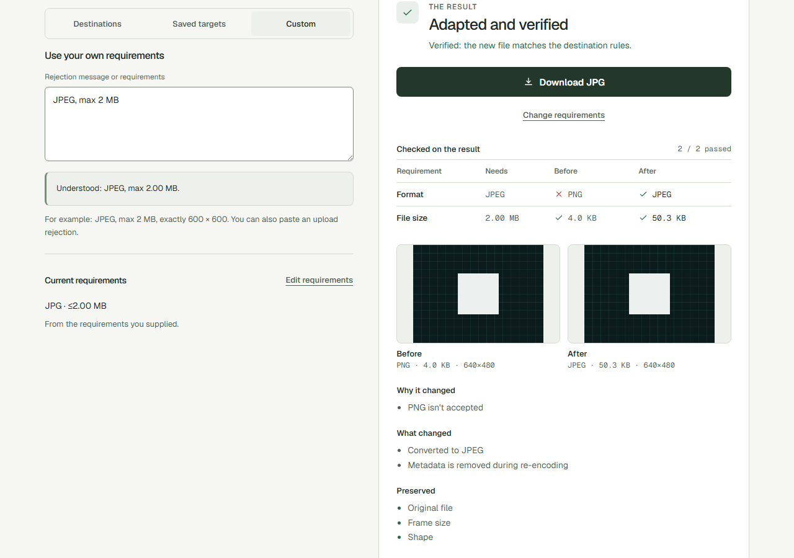
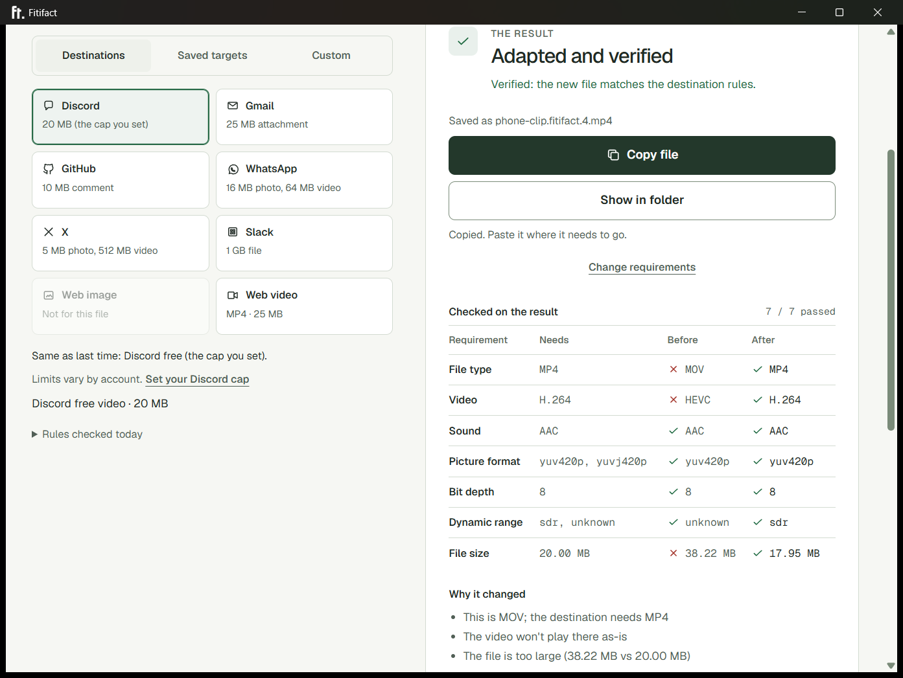

# Fitifact

**Make your file work there.**

[Try Fitifact](https://mattbaconz.github.io/fitifact/) ·
[Docs](https://mattbaconz.github.io/fitifact/docs/) ·
[Downloads](https://github.com/mattbaconz/fitifact/releases) ·
[Code signing policy](#code-signing-policy)

Fitifact is a destination-first file adapter. Drop a common photo, video, or
sound file, pick where it has to work, and it inspects the file, changes only
what that destination rejects, then verifies the result. Compatible files are a
no-op. Nothing is uploaded.





The public web app adapts still photos locally in the browser. The desktop
interface adds video and audio using bundled FFmpeg tools. Published release
archives currently verified are CLI builds, not desktop installers. See the
[desktop guide](https://mattbaconz.github.io/fitifact/docs/desktop-guide/) for
build and download guidance. Desktop installers are not code-signed yet; see the
[code signing policy](#code-signing-policy). The CLI uses FFmpeg and ffprobe
from PATH.

The browser, desktop interface, and static documentation share Fitifact’s
visual system, local appearance preference, and inspect → plan → adapt → validate
workflow. Start with a real sample, choose a destination or custom requirements,
review the changes and preservation, then download a validated result and its
report. Already compatible files keep their original bytes and filename.

JPEG, PNG, still WebP, TIFF, BMP, GIF, and single-image HEIC can be photo
inputs; outputs are JPEG or PNG, plus WebP when the confirmed target names it.
Animated GIF and animated WebP keep only the first frame after explicit consent.
Desktop and CLI video inputs include MP4, MOV, WebM, and MKV; typical outputs
are MP4 with H.264 and AAC. Audio-only inputs include MP3, WAV, FLAC, OGG, and
M4A; oversized or incompatible sound becomes AAC in MP4 when the destination
needs it, and already-accepted files are a no-op. Photo bytes stay in the browser worker and are
never uploaded to Fitifact.

```text
inspect -> constraints -> check -> plan -> execute -> validate
```

## Scope

Cargo, web, desktop, and docs are at `1.0.0-rc.1`, the first 1.0 candidate.
1.0.0 is the first stable version; there will be no `v0.1.0` or `v0.2.0` tag.

| Input and requested result | Behavior |
| --- | --- |
| MP4 with H.264 video and AAC audio already satisfying the target | No-op; no encoder starts |
| MOV, MKV, or WebM with H.264 video and AAC audio, target MP4/H.264/AAC, already safe | Remux without re-encoding when the byte ceiling already passes |
| HEVC, VP8, VP9, or AV1 video, target MP4/H.264/AAC | Transcode video to H.264; copy AAC when present |
| H.264 video with a non-AAC soundtrack | Encode audio to AAC and copy the video when that is enough |
| WAV, FLAC, MP3, or other common sound already under a size-only destination | No-op |
| Sound file over a byte ceiling, or a destination that needs AAC in MP4 | Encode AAC in MP4; refuse only at the quality floor |
| Sound file aimed at a video destination | Refuse; that destination is for video |
| Media file over a byte or dimension ceiling | Scale-to-fit and/or H.264 bitrate-ladder encode; refuse only at the quality floor |
| JPEG/PNG already satisfying the confirmed target | No-op |
| JPEG/PNG/still WebP/TIFF/BMP/GIF/HEIC requiring format, bounded resize, crop or first-frame consent, or byte fitting | In-process adaptation to JPEG, PNG, or WebP (when named) with re-inspection and validation |
| Animated PNG, AVIF, RAW, ZIP, PDF | Refuse explicitly |
| Any other mutation | Refuse explicitly |

Named destinations load from local YAML via `--for` (for example
`fitifact adapt clip.webm --for discord/video-upload`). Shipped presets cover
Discord, Gmail, WhatsApp, Slack, X, GitHub, a typical web image, and a typical
web video, plus size-only file uploads for sound and AI APIs (Anthropic and
OpenAI vision, OpenAI transcription). Each destination's
[page](https://mattbaconz.github.io/fitifact/docs/destinations/) lists its
rules, sources, and change history, and a weekly check flags sources that
change. The browser image provider
executes bounded image fitting. The desktop app ships FFmpeg as a sidecar
process for video and audio. The CLI uses FFmpeg from PATH. Neither surface
overwrites the input or an existing output, silently drops streams, or treats
provider success as proof of compatibility.

Public and default web builds include a lazy single-image HEIC decoder
(`libheif-js` 1.19.8) after local magic detection; notices ship with the app.
`FITIFACT_HEIC_APPROVED=false` remains a decoder-free proof build. Animation
as an output, hosted APIs, ffmpeg.wasm, package registries, OS signing, and
package-manager formulae stay deferred.

## Documentation

Curated public documentation lives in `apps/docs/content/docs`. Fumadocs and
Next.js produce a static export with browser-local search. `npm run build` in
`web` builds the Vite app and merges the docs into `web/dist/docs`. Set
`FITIFACT_BASE_PATH=/fitifact/` for the Pages artifact; the same build defaults
to `/` for local and desktop use. No hosted docs server is required.

## Requirements

- Rust toolchain with edition 2024 support (when building from source)
- For the **CLI**: `ffprobe` and `ffmpeg` on `PATH`
- For the **desktop app**: no FFmpeg install. The app ships `ffmpeg` and `ffprobe`. Optional env `FITIFACT_FFMPEG` / `FITIFACT_FFPROBE` override those paths.

Run `fitifact doctor` (or `fitifact doctor --json`) to verify versions,
`libx264`, MP4 muxing, and destination/temp write access. Doctor warns when the
FFmpeg major version is older than 6; CI currently tests FFmpeg 7.x. FFmpeg 6.x
is accepted without an age warning and is not rejected solely for age. Desktop
doctor reports shipped tools as ready instead of asking you to install FFmpeg.

Fitifact has no telemetry and performs no network activity. Building the
desktop app (not running it) downloads one pinned, hash-checked FFmpeg build
into a local sidecar folder. FFmpeg stays a separate process with its own
license, and Fitifact allows it to open local files only.

For the CLI, install FFmpeg from its official project or an operating-system
package source:
[FFmpeg's download page](https://ffmpeg.org/download.html) links official source
code and compiled-package providers.

```console
# Ubuntu/Debian
sudo apt update && sudo apt install ffmpeg

# macOS (Homebrew)
brew install ffmpeg

# Windows (WinGet)
winget install --id Gyan.FFmpeg -e
```

Confirm both `ffmpeg -version` and `ffprobe -version`, then run
`fitifact doctor`. The CLI's FFmpeg remains external software under the
license of the build you install. The desktop app ships a sidecar copy;
see `apps/desktop/FFMPEG-NOTICE.md`.

## Build and use

```console
cargo build --release --locked
cargo run -p fitifact-cli -- doctor
cargo run -p fitifact-cli -- inspect video.mp4
cargo run -p fitifact-cli -- check video.mp4 --container mp4 --video-codec h264 --audio-codec aac
cargo run -p fitifact-cli -- plan video.mov --container mp4 --video-codec h264 --audio-codec aac
cargo run -p fitifact-cli -- adapt video.mov --container mp4 --video-codec h264 --audio-codec aac
cargo run -p fitifact-cli -- adapt photo.png --image-format jpeg
cargo run -p fitifact-cli -- bench
```

The local web product lives under `web/`. Its pinned build invokes wasm-pack and
emits static assets under `web/dist`:

```console
cd web
npm ci
npm ci --prefix ../apps/docs
npm run build
npm run test:e2e
```

Use `--json` with every command for structured output; engine failures use
`fitifact.error/v1`. `fitifact bench` (and `fitifact bench --json`) is the
canonical demo: it times no-op, remux, HEVC transcode, JPEG no-op, and PNG
encode on the tracked fixtures and prints spawn/provider proofs. Run it from
the repository root so `fixtures/media` resolves; image fixtures are read from
the sibling `fixtures/image` directory.
Use `adapt --dry-run` to plan without writing a file. By default, adaptation
writes a unique sibling such as `video.fitifact.mp4` or `photo.fitifact.jpg`; `-o` chooses another new path and existing paths are
refused. The transform timeout defaults to 1800 seconds and can be set from 1
through 86400 seconds with `--timeout-seconds`.

Desktop packaging lives in [`apps/desktop/README.md`](apps/desktop/README.md).
The web UI is still-image only on GitHub Pages; the desktop host adds MP4, MOV,
WebM, MKV, and common audio (MP3, WAV, FLAC, M4A).

`--max-size` accepts exact whole bytes, decimal `MB`, or binary `MiB` (for
example `25000000`, `25 MB`, or `25 MiB`). `--max-base64-size` limits the
base64-encoded length instead, for APIs that take files inline. Adaptation plans are always recreated
from fresh inspection and typed constraints; saved JSON plans are never
executable input.

Typed constraints can also be loaded from YAML:

```console
cargo run -p fitifact-cli -- check video.mp4 --constraints fixtures/constraints/mp4-h264-aac.yaml
```

## AI tools (MCP)

`fitifact mcp` runs a [Model Context Protocol](https://modelcontextprotocol.io/)
server over stdio, so an AI client can call `list_destinations`, `inspect`,
`check`, and `fit` on local files. `fit` leaves a file that already fits
alone, asks before a crop or a first-frame change instead of making it,
validates every output against the same requirements, and saves it beside the
original without replacing any file; `dry_run` returns the plan only. The
client starts and stops the server; there is no daemon and no network. Client
setup is in [AI tools](https://mattbaconz.github.io/fitifact/docs/ai-tools/).

## Prepared release installation and verification

The public RC workflow produces ZIP or tar.gz
archives, `fitifact-cli-installer.sh`, `fitifact-cli-installer.ps1`, a unified
`sha256.sum`, per-archive SHA-256 files, and a CycloneDX
`fitifact-cli.cdx.xml` SBOM.

The checked-in package and binary version is the `1.0.0-rc.1` candidate.
Stable `1.0.0` requires a later reviewed version-bump commit after RC
acceptance; this commit must not receive the stable tag.

Download `sha256.sum` and the one archive for your target into the same
directory. Verify only that exact downloaded asset before extraction:

```console
# Linux x64
line="$(grep -E '^[0-9a-f]{64}  fitifact-cli-x86_64-unknown-linux-gnu\.tar\.gz$' sha256.sum)" && printf '%s\n' "$line" | sha256sum --check --strict -

# macOS Intel
line="$(grep -E '^[0-9a-f]{64}  fitifact-cli-x86_64-apple-darwin\.tar\.gz$' sha256.sum)" && printf '%s\n' "$line" | shasum --algorithm 256 --check -

# macOS Apple Silicon
line="$(grep -E '^[0-9a-f]{64}  fitifact-cli-aarch64-apple-darwin\.tar\.gz$' sha256.sum)" && printf '%s\n' "$line" | shasum --algorithm 256 --check -
```

Each `grep` pattern is anchored to one filename; a missing manifest entry makes
the pipeline fail. On Windows, select and compare the exact x64 ZIP entry:

```powershell
$asset = "fitifact-cli-x86_64-pc-windows-msvc.zip"
$entries = @(Select-String -Path .\sha256.sum -Pattern "^[0-9a-fA-F]{64}  $([regex]::Escape($asset))$")
if ($entries.Count -ne 1) { throw "Expected exactly one checksum entry for $asset" }
$expected = ($entries[0].Line -split '\s+', 2)[0]
$actual = (Get-FileHash ".\$asset" -Algorithm SHA256).Hash
if ($actual -ne $expected) { throw "SHA-256 mismatch for $asset" }
"$asset`: SHA-256 verified"
```

GitHub artifact attestations can be verified with GitHub CLI after replacing
`<archive>` with the downloaded release filename:

```console
gh attestation verify <archive> --repo mattbaconz/fitifact
```

The CycloneDX XML describes the resolved Cargo dependency graph and is released
alongside the archives. Windows binaries are not Authenticode-signed, and macOS
binaries are not code-signed or notarized in 1.0; users should expect platform
warnings and rely on the checksum, SBOM, attestation, and source/tag provenance.

If no prebuilt archive is suitable, the exact prepared source fallback is:

```console
cargo install --git https://github.com/mattbaconz/fitifact --locked fitifact-cli
```

This installs the current reviewed source from the public repository; release
archives remain the reproducible, attested distribution path.

## Code signing policy

Fitifact's Windows releases are not code-signed yet. Fitifact intends to apply
to SignPath Foundation for a free code signing certificate. Until a release is
signed, Windows shows an unknown-publisher warning; the checksums,
attestations, and source remain the way to verify a download.

Signed Windows releases will follow this policy:

Free code signing provided by [SignPath.io](https://about.signpath.io/),
certificate by [SignPath Foundation](https://signpath.org/).

- **What is signed:** only Fitifact's own Windows programs, the desktop app
  (`fitifact-desktop.exe`) and its installer, built by this repository's GitHub
  Actions workflows from a reviewed, tagged commit. Nothing built on a personal
  machine is signed.
- **What is not signed with this certificate:** the bundled FFmpeg programs
  (`ffmpeg.exe` and `ffprobe.exe`). They are upstream builds, shipped unchanged
  inside the signed installer; see
  [`apps/desktop/FFMPEG-NOTICE.md`](apps/desktop/FFMPEG-NOTICE.md).
- **Committers and reviewers:** [mattbaconz](https://github.com/mattbaconz).
  Changes from anyone else arrive as pull requests, and a committer reviews
  each one before it merges.
- **Approvers:** [mattbaconz](https://github.com/mattbaconz) approves every
  signing request by hand after checking that the release was built from the
  reviewed tag.
- **Account security:** every team member uses multi-factor authentication for
  GitHub and SignPath.
- **Privacy:** This program will not transfer any information to other
  networked systems unless specifically requested by the user or the person
  installing or operating it. It has no telemetry, and it runs the bundled
  FFmpeg programs with only local file access allowed.
- **Install and uninstall:** the installer adds Fitifact for the current user,
  with Start menu and desktop shortcuts and an Installed apps entry. If the
  Microsoft Edge WebView2 Runtime is missing (it ships with Windows 11), the
  installer first downloads and installs it from Microsoft. It changes no
  other system settings. Remove Fitifact from **Settings → Apps → Installed
  apps → Fitifact → Uninstall**, or run `uninstall.exe` in the install folder.
  Uninstalling keeps your Fitifact settings in
  `%LOCALAPPDATA%\com.mattbaconz.fitifact`; delete that folder to remove them
  too.

## Project status and distribution

The intended public home is
[`mattbaconz/fitifact`](https://github.com/mattbaconz/fitifact).
Distribution is GitHub-only; the Cargo packages are not published. Public
prerelease publication remains restricted to a protected, explicitly approved
release window.

See [`AGENTS.md`](AGENTS.md) for canonical project constraints.

## Contributing and security

Read [`CONTRIBUTING.md`](CONTRIBUTING.md) before proposing changes. Report
security issues privately as described in [`SECURITY.md`](SECURITY.md).

Licensed under the [Apache License 2.0](LICENSE).
